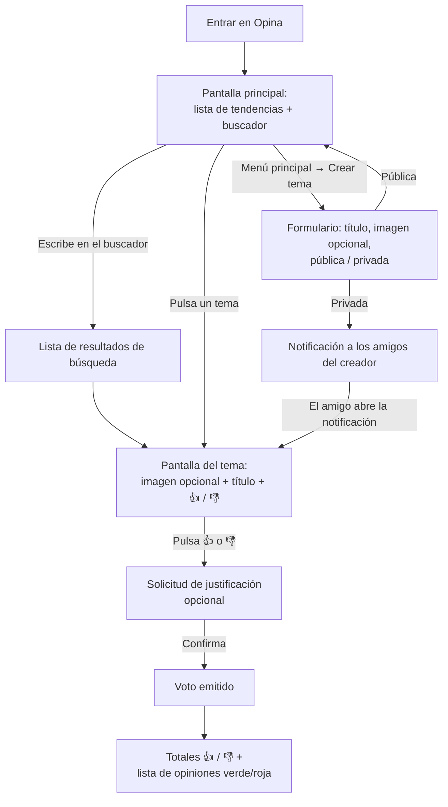

# 1. Descripción general del producto

## 1.1 Definición

**Opina** es una aplicación web y app Android, y una red social, basada en un sistema de **temas** sobre los que los usuarios pueden **votar**. Su propósito es ofrecer a los usuarios distintos temas sobre los que opinar, con una experiencia similar a la de un foro pero **más simplificada y dinámica**: en lugar de hilos de conversación, cada tema se resuelve con un voto positivo o negativo y, si el usuario lo desea, una breve justificación.

## 1.2 Objetivo del producto

Permitir que los usuarios expresen y consulten opiniones sobre temas de forma rápida:

1. Descubrir temas (tendencias o búsqueda).
2. Votar a favor o en contra de un tema, justificando opcionalmente el voto.
3. Consultar el resultado de la votación y las opiniones de otros usuarios.
4. Proponer nuevos temas, públicos para toda la comunidad o privados para sus amigos.

## 1.3 Características principales

| ID   | Característica                | Descripción                                                                                                                              |
| ---- | ----------------------------- | ---------------------------------------------------------------------------------------------------------------------------------------- |
| C-01 | Descubrimiento por tendencias | La pantalla principal muestra, en una lista scrolleable, los temas con mayor tendencia mientras no haya una búsqueda activa.             |
| C-02 | Búsqueda                      | Buscador en la parte superior de la pantalla principal.                                                                                  |
| C-03 | Vista de tema inmersiva       | Título del tema; si tiene imagen, esta ocupa la mitad superior de la pantalla del móvil.                                                 |
| C-04 | Votación binaria              | Dos botones: pulgar arriba (verde) y pulgar abajo (rojo).                                                                                |
| C-05 | Justificación opcional        | Tras pulsar un botón de voto se pide una justificación que el usuario puede dejar vacía.                                                 |
| C-06 | Resultados y opiniones        | Tras votar, los botones se transforman en los totales de votos y la lista de opiniones, en verde (voto positivo) o rojo (voto negativo). |
| C-07 | Creación de temas             | Cualquier usuario puede crear temas desde el menú principal.                                                                             |
| C-08 | Visibilidad pública / privada | Los temas públicos siguen el flujo general; los privados solo son accesibles para los amigos del creador.                                |
| C-09 | Notificación a amigos         | Al crear un tema privado, los amigos del creador reciben una notificación.                                                               |
| C-10 | Personas y amistades          | Menú inferior Temas / Personas / Perfil; buscar personas, ver su perfil y sus temas, y añadirlas o quitarlas de amigos.                  |
| C-12 | Mi perfil                     | Pestaña Perfil con mis datos, contadores, lista de amigos, mis temas, y edición de la foto y la descripción.                              |
| C-11 | Historias de amigos           | En la pantalla de temas, burbujas con los temas que los amigos han creado en las últimas 24 horas y el usuario aún no ha abierto.        |

## 1.4 Funcionalidades principales

### F-01 Pantalla principal

- Lista scrolleable de temas.
- Buscador en la parte superior.
- Sin búsqueda activa → se muestran las mayores tendencias.
- Con búsqueda activa → se muestran los temas que coinciden con el texto buscado.
- Cada tema se muestra en una tarjeta con su título, miniatura, total de votos y fecha de creación («hace 3 h», «12 sept»).
- Los temas que el usuario ya ha votado se marcan con fondo verde suave (voto a favor) o rojo suave (voto en contra) y muestran además sus votos a favor y en contra. En los no votados no se muestra el desglose (supuesto S-03).
- Acceso al menú principal, desde el que se crean temas.

### F-02 Acceso a un tema

- Al pulsar un tema de la lista se entra en su pantalla.
- Se muestra el título.
- Si el tema tiene imagen adjunta, aparece en la parte superior ocupando la mitad superior de la pantalla del móvil.
- En la parte inferior aparecen dos botones: pulgar arriba (verde) y pulgar abajo (rojo).

### F-03 Votación

1. El usuario pulsa uno de los dos botones.
2. Se le solicita una justificación del voto (opcional).
3. El usuario confirma y el voto queda emitido.
4. Los dos botones se sustituyen por:
   - Total de votos positivos.
   - Total de votos negativos.
   - Lista de opiniones de los usuarios que han comentado, en **verde** si su voto fue positivo y en **rojo** si fue negativo.

### F-04 Creación de temas

- Desde el menú principal.
- Datos del tema: título, imagen adjunta (opcional) y visibilidad (pública o privada).

### F-05 Temas públicos

- Accesibles a todos los usuarios según el funcionamiento general (F-01 a F-03).

### F-06 Temas privados

- Solo los usuarios de la lista de amigos del creador pueden acceder a la votación.
- Los amigos reciben una notificación indicando que un amigo ha creado una nueva propuesta.

### F-07 Personas y amistades

- Menú inferior con tres secciones: **Temas** (pantalla por defecto, F-01), **Personas** y **Perfil** (F-09).
- La pantalla Personas muestra un buscador y la lista de personas, con su foto de perfil (o inicial), su nombre y si son amigos o no.
- Al pulsar una persona se abre su perfil: foto, nombre y breve descripción; un check para añadirla o quitarla de amigos; y los temas que ha creado (los privados solo si se es su amigo), ordenables por más recientes o más puntuados (votos totales).
- La amistad se añade o quita directamente, sin solicitud, y es mutua.

### F-08 Historias de amigos

- Sobre la lista de la pantalla de temas, una fila de burbujas (como las historias de Instagram), una por cada amigo que ha creado temas en las últimas 24 horas que el usuario aún no ha abierto, públicos o privados. La fila se oculta durante una búsqueda y si no hay ninguna.
- Cada burbuja muestra la foto o inicial del amigo y su nombre, y un contador si tiene varios temas pendientes. Las más recientes van primero.
- Pulsar una burbuja abre el tema pendiente más antiguo de ese amigo. Abrir un tema ajeno, por la vía que sea, lo marca como visto y la burbuja se actualiza al volver.

### F-09 Mi perfil

- La pestaña **Perfil** abre mi perfil: foto (o inicial), nombre, descripción, los contadores «N temas» y «N amigos» y el botón «Editar perfil».
- **Amigos**: el contador de amigos abre mi lista de amigos, en orden alfabético, con la misma tarjeta que Personas. Como la amistad es mutua, seguidos y seguidores son la misma lista, así que se muestra una sola, «Amigos».
- **Mis temas**: todos los temas que he creado, también los privados (marcados «Privado»), con el mismo selector «Más recientes / Más puntuados» que el perfil de una persona.
- **Editar perfil**: cambiar o quitar la foto (JPEG, PNG o WebP de hasta 5 MB) y editar la descripción (hasta 160 caracteres). Los cambios se ven en toda la aplicación.

## 1.5 Flujo principal

## 1.6 Supuestos habilitantes y decisiones de interpretación

La descripción original no detalla algunos elementos imprescindibles para que las funcionalidades descritas puedan funcionar. Se incorporan **únicamente en su forma mínima** y no constituyen funcionalidades de producto adicionales:

| ID   | Supuesto / decisión                                          | Motivo                                                                                                                               | Alcance mínimo                                                                                                                                                                |
| ---- | ------------------------------------------------------------ | ------------------------------------------------------------------------------------------------------------------------------------ | ----------------------------------------------------------------------------------------------------------------------------------------------------------------------------- |
| S-01 | **Identificación de usuarios** (registro e inicio de sesión) | El voto es por usuario, las opiniones se atribuyen a usuarios, los temas tienen creador y existen listas de amigos y notificaciones. | Registro con nombre de usuario, email y contraseña; inicio y cierre de sesión. Perfil con foto y descripción opcionales, que el propio usuario edita desde su pestaña Perfil (F-09); sin recuperación de contraseña.   |
| S-02 | **Relación de amistad**                                      | Los temas privados dependen de "la lista de amigos del usuario".                                                                     | Se modela la relación de amistad en el sistema. Se añade y se quita desde el perfil de la persona (F-07), de forma directa y mutua, sin solicitud ni aceptación (resuelve Q-01). |
| S-03 | **Un voto por usuario y tema**, no modificable               | Coherente con "el usuario emitirá su voto" y con que, tras votar, la vista pasa a resultados.                                        | Si el usuario ya votó, al volver a entrar ve directamente los resultados.                                                                                                     |
| S-04 | **Definición de "tendencia"**                                | La descripción habla de "mayores tendencias" sin fórmula.                                                                            | Temas públicos ordenados por número total de votos (desc.) y, a igualdad, por fecha de creación (desc.).                                                                      |
| S-05 | **Opinión = voto con justificación**                         | "Las opiniones de los usuarios que hayan comentado".                                                                                 | Solo aparecen en la lista los votos con justificación no vacía; los totales incluyen todos los votos.                                                                         |
| S-06 | **Visibilidad de temas privados en listados**                | Los públicos siguen "el funcionamiento general"; los privados solo son accesibles a amigos.                                          | La lista de tendencias y la búsqueda muestran solo temas públicos. Un tema privado se abre desde la notificación o el perfil del creador (amigos) o por su creador.           |
| S-07 | **Notificaciones dentro de la aplicación**                   | No se especifica canal.                                                                                                              | Notificaciones internas listadas en una pantalla de notificaciones accesible desde el menú principal. Sin email ni push.                                                      |
| S-08 | **Búsqueda por título**                                      | El tema solo tiene título e imagen.                                                                                                  | Coincidencia parcial, sin distinguir mayúsculas/minúsculas, sobre el título.                                                                                                  |
| S-09 | **App Android con la interfaz empaquetada**                  | Se pide poder usar Opina como app móvil, no solo desde el navegador.                                                                 | APK de Android (Capacitor) con las mismas pantallas y reglas que la web, conectada a la API desplegada. Sesión por token, botón atrás, pantalla de arranque y pantalla «Sin conexión». Cambio `app-movil-empaquetada`. |

## 1.7 Fuera de alcance

No forman parte del producto (no se mencionan en la descripción): edición o borrado de temas, cambio o retirada de votos, respuestas a opiniones, "me gusta" en opiniones, solicitudes de amistad con aceptación, moderación, gestión de cuenta/recuperación de contraseña, categorías o etiquetas, compartir en redes externas, notificaciones por email/push, app para iOS y uso sin conexión (sin red, la app Android solo muestra «Sin conexión»).

## 1.8 Cuestiones abiertas

| ID   | Cuestión                                                                           | Impacto                                                                                                                 |
| ---- | ---------------------------------------------------------------------------------- | ----------------------------------------------------------------------------------------------------------------------- |
| Q-01 | ~~¿Cómo se forma la lista de amigos (solicitudes, aceptación, búsqueda de usuarios)?~~ | **Resuelta** por F-07: búsqueda de personas y check directo en el perfil (cambio `personas-y-amistades`).             |
| Q-02 | ¿Debe la fórmula de tendencia considerar la actividad reciente?                    | Solo afecta al criterio de ordenación (S-04); aislado en un único servicio.                                             |
| Q-03 | ¿Pueden los amigos encontrar temas privados desde la búsqueda o la lista?          | Afecta a S-06; aislado en la política de visibilidad.                                                                   |
| Q-04 | ¿Deben las amistades requerir solicitud y aceptación?                              | Hoy cualquiera puede añadir a otra persona y ver así sus temas privados; la API permitiría añadir un estado pendiente.   |
