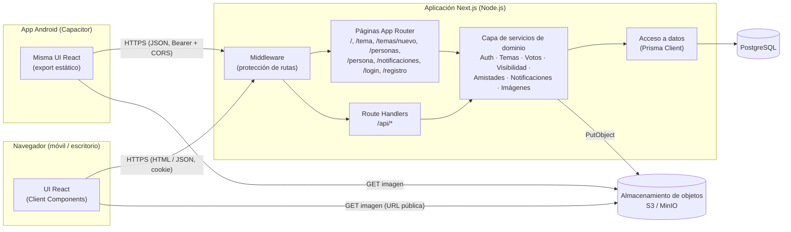
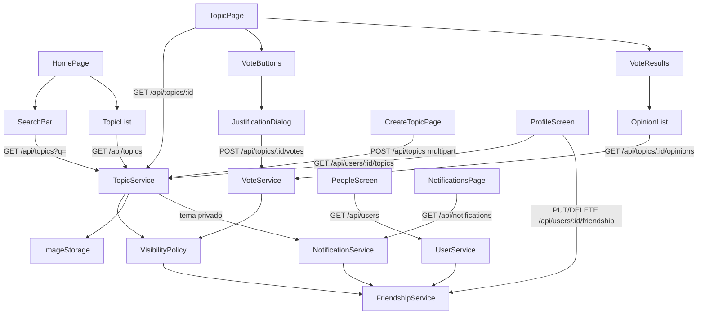
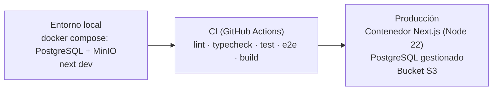

# 2. Arquitectura del sistema

## 2.1 Visión general

Opina se construye como un **monolito modular full-stack** sobre Next.js (App Router), desplegado como una única aplicación web _mobile-first_. La aplicación expone una interfaz web y una API HTTP (Route Handlers) que consumen los componentes cliente. La misma interfaz se exporta como archivos estáticos y se empaqueta en una **app Android** (Capacitor), que usa la API desplegada con un token Bearer (§2.9). La persistencia se realiza en **PostgreSQL** y las imágenes de los temas se guardan en un **almacenamiento de objetos S3-compatible**.

Se elige un monolito porque el dominio es pequeño (usuarios, temas, votos, amistades y notificaciones), con un único equipo y sin requisitos de escalado independiente: minimiza la complejidad operativa y permite que cada incremento SDD toque todas las capas en un solo cambio.



## 2.2 Capas y responsabilidades

| Capa                                                          | Responsabilidad                                                                                   | Reglas                                                                      |
| ------------------------------------------------------------- | ------------------------------------------------------------------------------------------------- | --------------------------------------------------------------------------- |
| **Presentación** (`src/app`, `src/components`)                | Pantallas, navegación, estado de UI, llamadas a la API.                                           | No contiene reglas de negocio; solo valida formato para feedback inmediato. |
| **API** (`src/app/api/**/route.ts`)                           | Contrato HTTP: autenticación de la petición, validación con Zod, mapeo de errores a códigos HTTP. | Delgada: delega siempre en servicios.                                       |
| **Servicios de dominio** (`src/server/services`)              | Reglas de negocio: tendencias, búsqueda, voto único, visibilidad, notificaciones.                 | Funciones puras sobre repositorios; testeables con base de datos de prueba. |
| **Acceso a datos** (`src/server/db`)                          | Prisma Client y consultas.                                                                        | Único punto de acceso a PostgreSQL.                                         |
| **Infraestructura** (`src/server/storage`, `src/server/auth`) | Subida de imágenes a S3, configuración de Auth.js.                                                | Detrás de interfaces para poder sustituirlas en tests.                      |

## 2.3 Componentes principales

### Frontend (pantallas y componentes)

| Componente                    | Ruta / ubicación      | Descripción                                                                                       | HU           |
| ----------------------------- | --------------------- | ------------------------------------------------------------------------------------------------- | ------------ |
| `LoginPage`, `RegisterPage`   | `/login`, `/registro` | Formularios de identificación (supuesto S-01).                                                    | HU-00        |
| `MainMenu`                    | Layout global         | Menú principal con acceso a "Crear tema", "Notificaciones" y cierre de sesión.                    | HU-08, HU-12 |
| `HomePage`                    | `/`                   | Contiene `SearchBar` (superior) y `TopicList`.                                                    | HU-01, HU-02 |
| `SearchBar`                   | `HomePage`            | Campo de búsqueda con _debounce_ (300 ms); vacío → tendencias.                                    | HU-02        |
| `TopicList` / `TopicListItem` | `HomePage`            | Lista scrolleable con carga incremental (scroll infinito por cursor).                             | HU-01        |
| `TopicPage` / `TopicScreen`   | `/tema?id=`           | Pantalla de un tema. Decide entre `VoteButtons` o `VoteResults` según si el usuario ya ha votado. | HU-03        |
| `TopicImage`                  | `TopicPage`           | Imagen a `50dvh` (mitad superior de la pantalla) con `object-fit: cover`. Solo si existe.         | HU-03        |
| `VoteButtons`                 | `TopicPage`           | Botón 👍 verde y botón 👎 rojo en la parte inferior.                                              | HU-04        |
| `JustificationDialog`         | `TopicPage`           | Diálogo que solicita la justificación opcional y confirma el voto.                                | HU-05        |
| `VoteResults`                 | `TopicPage`           | Totales positivos/negativos + `OpinionList`. Sustituye a `VoteButtons`.                           | HU-06, HU-07 |
| `OpinionList` / `OpinionItem` | `VoteResults`         | Opiniones en verde (positivo) o rojo (negativo).                                                  | HU-07        |
| `CreateTopicPage`             | `/temas/nuevo`        | Formulario: título, imagen opcional, selector público/privado.                                    | HU-08..HU-10 |
| `NotificationsPage`           | `/notificaciones`     | Lista de notificaciones; cada una enlaza al tema privado.                                         | HU-12        |
| `BottomNav`                   | Layout `(main)`       | Menú inferior amarillo con las secciones Temas, Personas y Perfil; marca la sección activa.       | HU-13, HU-21 |
| `StoriesBar`                  | `HomePage`            | Fila de burbujas con los temas nuevos de amigos (últimas 24 h, no vistos); oculta con búsqueda.  | HU-19        |
| `PeopleScreen` / `PeopleList` | `/personas`           | Buscador y lista de personas con indicador «Amigo» / «No amigo» (scroll infinito).               | HU-13        |
| `PersonScreen` / `ProfileScreen` | `/persona?id=`     | Cabecera con foto, nombre y descripción; `FriendToggle`; `SortSelector` y temas de la persona.    | HU-14, HU-15 |
| `MyProfileScreen`             | `/perfil`             | Mi perfil: cabecera con contadores y «Editar perfil»; «Mis temas» (incluye privados) con orden.   | HU-21        |
| `MyFriendsScreen`             | `/perfil/amigos`      | Mis amigos en orden alfabético con scroll infinito (seguidos = seguidores: amistad mutua).        | HU-21        |
| `EditProfileScreen`           | `/perfil/editar`      | Cambiar o quitar la foto (vista previa) y editar la descripción (≤ 160, con contador).            | HU-20        |

### Backend (servicios de dominio)

| Servicio              | Responsabilidades                                                                                                                                                                              |
| --------------------- | ---------------------------------------------------------------------------------------------------------------------------------------------------------------------------------------------- |
| `AuthService`         | Registro (hash bcrypt), verificación de credenciales, obtención del usuario de la sesión.                                                                                                      |
| `TopicService`        | `listTrending(cursor)`, `search(query, cursor)`, `getById(id, viewer)`, `create(input, author)`, `listByAuthor({ authorId, viewerId, sort, cursor })`.                                                                                               |
| `StoryService`        | `listForUser(viewerId)`: amigos con temas creados en las últimas 24 h que el usuario no ha abierto, y sus identificadores. `TopicService.getById` registra la visita (`topic_views`). |
| `VisibilityPolicy`    | `canAccess(topic, viewer)`: público → sí; privado → sí si es el creador o amigo del creador. Usada por todos los accesos a un tema.                                                            |
| `VoteService`         | `castVote(topicId, user, value, justification?)` en transacción: comprueba acceso, garantiza voto único, actualiza contadores. `getResults(topicId, viewer)`. `listOpinions(topicId, cursor)`. |
| `FriendshipService`   | `getFriendIds(userId)`, `areFriends(a, b)`, `add(userId, friendId)` y `remove(userId, friendId)` (simétricos, atómicos e idempotentes).                                                        |
| `UserService`         | `search({ viewerId, q?, cursor? })` (personas con `isFriend`), `getProfile(id, viewerId)`.                                                                                                      |
| `NotificationService` | `notifyFriendsOfPrivateTopic(topic)` (en la misma transacción que la creación), `listForUser(userId, cursor)`.                                                                                 |
| `ImageStorage`        | `upload(file) → url`: valida tipo/tamaño, genera clave única y sube a S3.                                                                                                                      |

## 2.4 Relación entre componentes



### Secuencia: votar un tema

```mermaid
sequenceDiagram
    actor U as Usuario
    participant P as TopicPage
    participant D as JustificationDialog
    participant A as POST /api/topics/:id/votes
    participant V as VoteService
    participant DB as PostgreSQL

    U->>P: Pulsa 👍 (o 👎)
    P->>D: Abre diálogo (valor = UP)
    U->>D: Escribe justificación (opcional) y confirma
    D->>A: { value: "UP", justification?: "..." }
    A->>V: castVote(topicId, user, UP, justification)
    V->>DB: BEGIN; comprobar acceso; INSERT vote; UPDATE topic counters; COMMIT
    alt ya había votado
        DB-->>V: violación UNIQUE(topicId, userId)
        V-->>A: AlreadyVotedError
        A-->>D: 409 Conflict
    else voto nuevo
        V-->>A: resultados { positiveVotes, negativeVotes }
        A-->>D: 201 Created
        D->>P: Sustituye VoteButtons por VoteResults
        P->>A: GET /api/topics/:id/opinions
    end
```

### Secuencia: crear un tema privado

```mermaid
sequenceDiagram
    actor U as Creador
    participant C as CreateTopicPage
    participant A as POST /api/topics
    participant T as TopicService
    participant S as ImageStorage
    participant N as NotificationService
    participant DB as PostgreSQL

    U->>C: Título + imagen (opcional) + "Privado"
    C->>A: multipart/form-data
    A->>T: create(input, author)
    opt Imagen adjunta
        T->>S: upload(file)
        S-->>T: imageUrl
    end
    T->>DB: BEGIN; INSERT topic (PRIVATE)
    T->>N: notifyFriendsOfPrivateTopic(topic)
    N->>DB: SELECT amigos; INSERT notification × N; COMMIT
    A-->>C: 201 { id }
    C->>U: Redirige a /temas/:id
```

## 2.5 Contrato de la API

Todas las rutas (salvo registro y endpoints de Auth.js) requieren sesión: la cookie de la web o `Authorization: Bearer <token>` de la app. Sin ella devuelven `401`. Las respuestas de error siguen el formato `{ "error": { "code": string, "message": string } }`.

| Método y ruta                          | Entrada                                                                                                     | Respuesta OK                                   | Errores                                         | HU                  |
| -------------------------------------- | ----------------------------------------------------------------------------------------------------------- | ---------------------------------------------- | ----------------------------------------------- | ------------------- |
| `POST /api/register`                   | `{ username, email, password }`                                                                             | `201 { id, username }`                         | `400` validación, `409` usuario/email existente | HU-00               |
| `/api/auth/*`                          | Gestionado por Auth.js (Credentials)                                                                        | —                                              | —                                               | HU-00               |
| `POST /api/auth/token`                 | `{ email, password }` (app Android)                                                                         | `200 { token, user: { id, username } }`        | `401` "Credenciales incorrectas"                | HU-00, HU-16        |
| `GET /api/topics?cursor=`              | Sin `q` → tendencias                                                                                        | `200 { items: TopicSummary[], nextCursor }`    | —                                               | HU-01               |
| `GET /api/topics?q=texto&cursor=`      | `q` 1–100 caracteres                                                                                        | `200 { items: TopicSummary[], nextCursor }`    | `400`                                           | HU-02               |
| `GET /api/topics/:id`                  | —                                                                                                           | `200 TopicDetail`                              | `404` inexistente o sin acceso                  | HU-03, HU-11        |
| `POST /api/topics/:id/votes`           | `{ value: "UP"\|"DOWN", justification?: string ≤ 500 }`                                                     | `201 { positiveVotes, negativeVotes, myVote }` | `400`, `404`, `409` ya votado                   | HU-04, HU-05        |
| `GET /api/topics/:id/opinions?cursor=` | —                                                                                                           | `200 { items: Opinion[], nextCursor }`         | `403` si no ha votado, `404`                    | HU-07               |
| `POST /api/topics`                     | `multipart/form-data`: `title` (3–120), `visibility` (`PUBLIC`\|`PRIVATE`), `image?` (JPEG/PNG/WebP ≤ 5 MB) | `201 { id }`                                   | `400`, `413`, `415`                             | HU-08..HU-10, HU-12 |
| `GET /api/notifications?cursor=`       | —                                                                                                           | `200 { items: Notification[], nextCursor }`    | —                                               | HU-12               |
| `GET /api/users?q=&cursor=`            | `q` 1–100 caracteres (opcional)                                                                             | `200 { items: Person[], nextCursor }`          | `400`                                           | HU-13               |
| `GET /api/media/:clave`                | `clave`: `avatars/<uuid>.<ext>` o `topics/<uuid>.<ext>` (ruta pública)                                      | `200` imagen con su `Content-Type`             | `404` clave inexistente o inválida              | HU-22               |
| `GET /api/health`                      | — (ruta pública)                                                                                            | `200 { status: "ok" }`                         | —                                               | HU-16, HU-22        |
| `GET /api/stories`                     | —                                                                                                           | `200 { items: Story[] }`                       | —                                               | HU-19               |
| `GET /api/me`                          | —                                                                                                           | `200 { id, username, avatarUrl, bio, topicsCount, friendsCount }` | —                                | HU-21               |
| `GET /api/me/friends?cursor=`          | —                                                                                                           | `200 { items: Person[], nextCursor }`          | —                                               | HU-21               |
| `PATCH /api/me`                        | `multipart/form-data`: `bio?` (≤ 160), `avatar?` (JPEG/PNG/WebP ≤ 5 MB), `removeAvatar?`                    | `200` perfil actualizado                       | `400`, `413`, `415`                             | HU-20               |
| `GET /api/users/:id`                   | —                                                                                                           | `200 UserProfile`                              | `404` id inválido o persona inexistente         | HU-14, HU-16        |
| `GET /api/users/:id/topics?sort=&cursor= | `sort`: `recent` (defecto) \| `top`                                                                       | `200 { items: TopicSummary[], nextCursor }`    | `400`, `404` persona inexistente                | HU-14               |
| `PUT /api/users/:id/friendship`        | —                                                                                                           | `200 { isFriend: true }`                       | `400` uno mismo, `404`                          | HU-15               |
| `DELETE /api/users/:id/friendship`     | —                                                                                                           | `200 { isFriend: false }`                      | `400` uno mismo, `404`                          | HU-15               |

Las imágenes subidas se devuelven como ruta relativa (`/api/media/…`) y las externas con su URL completa.

**Tipos de respuesta**

```ts
type TopicSummary = {
  id: string;
  title: string;
  imageUrl: string | null;
  visibility: "PUBLIC" | "PRIVATE";
  totalVotes: number;
  createdAt: string;
  myVote: "UP" | "DOWN" | null;
  // Solo presente si myVote !== null (supuesto S-03)
  results?: { positiveVotes: number; negativeVotes: number };
};

type TopicDetail = {
  id: string;
  title: string;
  imageUrl: string | null;
  visibility: "PUBLIC" | "PRIVATE";
  myVote: "UP" | "DOWN" | null;
  // Solo presentes si myVote !== null
  results?: { positiveVotes: number; negativeVotes: number };
};

type Story = {
  author: { id: string; username: string; avatarUrl: string | null };
  topicIds: string[]; // pendientes, del más antiguo al más nuevo
  latestCreatedAt: string;
};

type Opinion = {
  id: string;
  username: string;
  value: "UP" | "DOWN";
  justification: string;
  createdAt: string;
};

type Notification = {
  id: string;
  type: "PRIVATE_TOPIC_CREATED";
  actor: { username: string };
  topic: { id: string; title: string };
  createdAt: string;
};
```

**Paginación:** por cursor opaco (codifica el criterio de orden + `id`), tamaño de página 20.

## 2.6 Aspectos transversales

| Aspecto                 | Decisión                                                                                                                                             |
| ----------------------- | ---------------------------------------------------------------------------------------------------------------------------------------------------- |
| **Autenticación**       | Web: Auth.js v5, proveedor Credentials, sesión JWT en cookie `httpOnly`, `secure`, `sameSite=lax`; el middleware redirige a `/login` las páginas protegidas. App Android: token JWE de Auth.js (sal propia, 30 días) en `Authorization: Bearer`; `AuthGate` protege las pantallas en el cliente. |
| **CORS**                | Solo para los orígenes de la app (`https://localhost`, `http://localhost`, `capacitor://localhost`), sin credenciales de cookie.                   |
| **Autorización**        | `VisibilityPolicy` es el único punto que decide el acceso a un tema. Un tema privado inaccesible responde `404` para no revelar su existencia.       |
| **Integridad del voto** | Restricción `UNIQUE (topic_id, user_id)` en BD + transacción que incrementa contadores desnormalizados.                                              |
| **Validación**          | Esquemas Zod compartidos entre cliente y servidor (`src/lib/validation`).                                                                            |
| **Imágenes**            | Validación de tipo por _magic bytes_ y tamaño ≤ 5 MB; clave aleatoria (`topics/<uuid>.<ext>`); se sirve por URL pública del bucket. Las fotos de perfil usan el prefijo `avatars/` (`PATCH /api/me`), y la anterior se borra al cambiarla. |
| **Rendimiento**         | Índices para tendencias y búsqueda (ver modelo de datos); scroll infinito con cursor.                                                                |
| **Diseño responsive**   | _Mobile-first_ con Tailwind; la imagen usa `50dvh`; botones de voto fijados en la parte inferior.                                                    |
| **Accesibilidad**       | Los colores verde/rojo se acompañan de icono 👍/👎 y texto accesible (`aria-label`) para no depender solo del color.                                 |
| **Errores y logs**      | Errores de dominio tipados → mapeo a HTTP en la capa API; log estructurado en servidor.                                                              |

## 2.7 Estructura de carpetas

```
opina/
├── prisma/
│   ├── schema.prisma
│   ├── migrations/
│   └── seed.ts                 # Usuarios, amistades y temas de ejemplo
├── src/
│   ├── app/
│   │   ├── (auth)/login/page.tsx
│   │   ├── (auth)/registro/page.tsx
│   │   ├── page.tsx                    # HomePage
│   │   ├── tema/page.tsx               # TopicPage (/tema?id=)
│   │   ├── temas/nuevo/page.tsx        # CreateTopicPage
│   │   ├── notificaciones/page.tsx
│   │   ├── personas/page.tsx           # PeopleScreen
│   │   ├── persona/page.tsx            # ProfilePage (/persona?id=)
│   │   ├── perfil/page.tsx             # MyProfileScreen
│   │   ├── perfil/amigos/page.tsx      # MyFriendsScreen
│   │   ├── perfil/editar/page.tsx      # EditProfileScreen
│   │   └── api/
│   │       ├── auth/[...nextauth]/route.ts
│   │       ├── auth/token/route.ts
│   │       ├── register/route.ts
│   │       ├── topics/route.ts
│   │       ├── topics/[id]/route.ts
│   │       ├── topics/[id]/votes/route.ts
│   │       ├── topics/[id]/opinions/route.ts
│   │       ├── notifications/route.ts
│   │       ├── me/route.ts
│   │       ├── me/friends/route.ts
│   │       ├── users/route.ts
│   │       ├── users/[id]/route.ts
│   │       ├── users/[id]/topics/route.ts
│   │       └── users/[id]/friendship/route.ts
│   ├── components/             # UI (TopicList, VoteButtons, OpinionList…)
│   ├── lib/validation/         # Esquemas Zod compartidos
│   ├── lib/platform/           # apiFetch, token de la app, detección del build móvil
│   ├── lib/auth/client.ts      # login / logout para web y app
│   ├── server/
│   │   ├── auth/               # Configuración Auth.js
│   │   ├── db/                 # Prisma Client
│   │   ├── services/           # Topic, Vote, Visibility, Friendship, Notification, User
│   │   ├── storage/            # ImageStorage (S3)
│   │   └── errors.ts           # Errores de dominio
│   └── middleware.ts
├── tests/
│   ├── unit/  ├── integration/  └── e2e/
├── android/                    # Proyecto nativo de Capacitor
├── capacitor.config.ts
├── scripts/                    # build-mobile, android-gradle, generate-app-assets
├── docker-compose.yml          # PostgreSQL + MinIO
└── openspec/
```

## 2.8 Despliegue



Variables de entorno: `DATABASE_URL`, `AUTH_SECRET`, `S3_ENDPOINT`, `S3_REGION`, `S3_BUCKET`, `S3_ACCESS_KEY_ID`, `S3_SECRET_ACCESS_KEY`, `S3_PUBLIC_URL`.

## 2.9 App Android

La app Android empaqueta la misma interfaz que la web (cambio `app-movil-empaquetada`, HU-16):

| Pieza | Decisión |
| --- | --- |
| **Build** | `OPINA_TARGET=mobile` activa en `next.config.ts` `output: "export"` (carpeta `out-mobile`), `trailingSlash`, imágenes sin optimizar y `pageExtensions: ["tsx", "js"]`, que deja fuera las rutas de la API, el middleware y el manifest (`.ts`). Next compila igualmente en `.next`. |
| **Rutas** | Tema y perfil usan parámetro de consulta (`/tema?id=`, `/persona?id=`) porque el export no conoce los identificadores al compilar. En la web, `/temas/:id` y `/personas/:id` redirigen de forma permanente. |
| **Datos** | Todas las pantallas cargan sus datos desde el cliente con TanStack Query. `apiFetch` antepone `NEXT_PUBLIC_API_URL` y, en la app, el token. |
| **Sesión** | `POST /api/auth/token` → token guardado con `@capacitor/preferences`. Un `401` borra el token y lleva a `/login`. |
| **Nativo** | `NativeShell`: botón atrás (`@capacitor/app`), barra de estado verde, pantalla de arranque y pantalla «Sin conexión» (`@capacitor/network`). |
| **Entornos** | `npm run build:mobile:dev` usa por defecto `http://localhost:3000` por `adb reverse` (origen `http://localhost`). `NEXT_PUBLIC_API_URL=https://… npm run build:mobile` para producción. |
| **Servidor configurable** | Solo en el build de desarrollo (`NEXT_PUBLIC_OPINA_SERVER_CONFIGURABLE`): la pantalla `/servidor` guarda la dirección del servidor en `@capacitor/preferences`, tras comprobar `GET /api/health`. `server-store` la ofrece de forma síncrona a `apiFetch` y a `resolveMediaUrl`. Cambiar de servidor cierra la sesión. |
| **Imágenes** | `GET /api/media/{clave}` (pública, caché `immutable`) sirve `avatars/` y `topics/` desde el almacenamiento. La base de datos guarda la clave y la API devuelve `/api/media/…` (`toMediaUrl`); el cliente la resuelve contra el servidor en uso. Las URLs externas (seed) no cambian. |
| **HTTP sin cifrar** | Solo el APK `debug` (`network_security_config` en `src/debug`); el release lo bloquea. |
