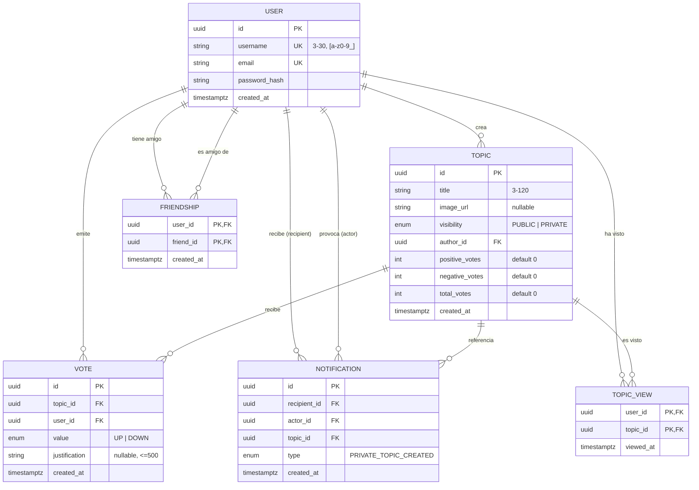

# 3. Modelo de datos

## 3.1 Entidades

| Entidad          | Descripción                                                                                                                     | Origen             |
| ---------------- | ------------------------------------------------------------------------------------------------------------------------------- | ------------------ |
| **User**         | Usuario de la aplicación.                                                                                                       | S-01 (habilitante) |
| **Friendship**   | Relación de amistad entre dos usuarios; define "la lista de amigos".                                                            | §6.2 / S-02        |
| **Topic**        | Tema o propuesta sobre la que se vota. Tiene título, imagen opcional y visibilidad.                                             | §5, §6             |
| **Vote**         | Voto (positivo/negativo) de un usuario sobre un tema, con justificación opcional. Un voto con justificación es una **opinión**. | §5.3               |
| **Notification** | Aviso a un amigo de que un usuario ha creado un tema privado.                                                                   | §6.2               |
| **TopicView**    | Registro de que un usuario ha abierto un tema ajeno; alimenta las historias de amigos.                                          | F-08               |

## 3.2 Diagrama entidad-relación



## 3.3 Descripción de atributos y reglas

### User

| Campo          | Tipo         | Reglas                                                               |
| -------------- | ------------ | -------------------------------------------------------------------- |
| `id`           | UUID         | PK                                                                   |
| `username`     | varchar(30)  | Único, 3–30 caracteres `[a-z0-9_]`. Se muestra junto a cada opinión. |
| `email`        | varchar(254) | Único, normalizado a minúsculas.                                     |
| `passwordHash` | varchar      | bcrypt (coste 12). Nunca se expone por la API.                       |
| `avatarUrl`    | text, nulo   | Foto de perfil: clave del almacenamiento (`avatars/<uuid>.<ext>`) o URL externa (seed). Sin valor → se muestra la inicial (F-07). |
| `bio`          | varchar(160), nulo | Descripción breve del perfil (F-07).                           |
| `createdAt`    | timestamptz  | `now()`                                                              |

### Friendship

- Relación **simétrica** almacenada como **dos filas** (`A→B` y `B→A`) para que "amigos de X" sea una consulta directa por `user_id`.
- PK compuesta `(user_id, friend_id)`; `CHECK (user_id <> friend_id)`.
- Se crea y se borra desde la aplicación (F-07, `FriendshipService.add` / `remove`): siempre las dos filas a la vez, en una transacción e idempotente. También se puebla por `prisma/seed.ts`.

### Topic

| Campo                                          | Tipo                       | Reglas                                                                                                                                            |
| ---------------------------------------------- | -------------------------- | ------------------------------------------------------------------------------------------------------------------------------------------------- |
| `title`                                        | varchar(120)               | Obligatorio, 3–120 caracteres tras `trim`.                                                                                                        |
| `imageUrl`                                     | text, nullable             | Clave del objeto en el almacenamiento (`topics/<uuid>.<ext>`) o URL externa (seed); la API la expone como `/api/media/…`. Si es `null`, no se muestra imagen. |
| `visibility`                                   | enum `PUBLIC` \| `PRIVATE` | Obligatorio.                                                                                                                                      |
| `authorId`                                     | UUID FK → User             | Creador.                                                                                                                                          |
| `positiveVotes`, `negativeVotes`, `totalVotes` | int ≥ 0                    | Contadores desnormalizados, actualizados en la misma transacción que la inserción del voto. `totalVotes = positiveVotes + negativeVotes` (CHECK). |

### Vote

| Campo           | Tipo                         | Reglas                                                        |
| --------------- | ---------------------------- | ------------------------------------------------------------- |
| `value`         | enum `UP` \| `DOWN`          | `UP` = pulgar arriba (verde), `DOWN` = pulgar abajo (rojo).   |
| `justification` | varchar(500), nullable       | Opcional. Cadena vacía o solo espacios se guarda como `NULL`. |
| —               | UNIQUE `(topic_id, user_id)` | Un único voto por usuario y tema (S-03).                      |

**Opinión** = `Vote` con `justification IS NOT NULL` (S-05).

### Notification

| Campo         | Tipo            | Reglas                                |
| ------------- | --------------- | ------------------------------------- |
| `recipientId` | UUID FK → User  | Amigo del creador.                    |
| `actorId`     | UUID FK → User  | Creador del tema.                     |
| `topicId`     | UUID FK → Topic | Tema privado creado.                  |
| `type`        | enum            | Único valor: `PRIVATE_TOPIC_CREATED`. |

### TopicView

| Campo      | Tipo            | Reglas                                                                                   |
| ---------- | --------------- | ---------------------------------------------------------------------------------------- |
| `userId`   | UUID FK → User  | Quien abrió el tema. Parte de la clave primaria; `ON DELETE CASCADE`.                    |
| `topicId`  | UUID FK → Topic | Tema abierto (de otro autor). Parte de la clave primaria; `ON DELETE CASCADE`.           |
| `viewedAt` | timestamptz     | Primera visita. Se registra con `INSERT … ON CONFLICT DO NOTHING`: una fila por pareja. |

## 3.4 Esquema Prisma

```prisma
generator client {
  provider = "prisma-client-js"
}

datasource db {
  provider = "postgresql"
  url      = env("DATABASE_URL")
}

enum Visibility {
  PUBLIC
  PRIVATE
}

enum VoteValue {
  UP
  DOWN
}

enum NotificationType {
  PRIVATE_TOPIC_CREATED
}

model User {
  id                 String         @id @default(uuid()) @db.Uuid
  username           String         @unique @db.VarChar(30)
  email              String         @unique @db.VarChar(254)
  passwordHash       String         @map("password_hash")
  avatarUrl          String?        @map("avatar_url")
  bio                String?        @db.VarChar(160)
  createdAt          DateTime       @default(now()) @map("created_at") @db.Timestamptz
  topics             Topic[]
  votes              Vote[]
  friendships        Friendship[]   @relation("UserFriendships")
  friendOf           Friendship[]   @relation("FriendOf")
  notifications      Notification[] @relation("NotificationRecipient")
  actedNotifications Notification[] @relation("NotificationActor")

  @@map("users")
}

model Friendship {
  userId    String   @map("user_id") @db.Uuid
  friendId  String   @map("friend_id") @db.Uuid
  createdAt DateTime @default(now()) @map("created_at") @db.Timestamptz
  user      User     @relation("UserFriendships", fields: [userId], references: [id], onDelete: Cascade)
  friend    User     @relation("FriendOf", fields: [friendId], references: [id], onDelete: Cascade)

  @@id([userId, friendId])
  @@index([friendId])
  @@map("friendships")
}

model Topic {
  id            String         @id @default(uuid()) @db.Uuid
  title         String         @db.VarChar(120)
  imageUrl      String?        @map("image_url")
  visibility    Visibility
  authorId      String         @map("author_id") @db.Uuid
  positiveVotes Int            @default(0) @map("positive_votes")
  negativeVotes Int            @default(0) @map("negative_votes")
  totalVotes    Int            @default(0) @map("total_votes")
  createdAt     DateTime       @default(now()) @map("created_at") @db.Timestamptz
  author        User           @relation(fields: [authorId], references: [id], onDelete: Cascade)
  votes         Vote[]
  notifications Notification[]

  @@index([visibility, totalVotes(sort: Desc), createdAt(sort: Desc), id])
  @@index([authorId])
  @@map("topics")
}

model Vote {
  id            String    @id @default(uuid()) @db.Uuid
  topicId       String    @map("topic_id") @db.Uuid
  userId        String    @map("user_id") @db.Uuid
  value         VoteValue
  justification String?   @db.VarChar(500)
  createdAt     DateTime  @default(now()) @map("created_at") @db.Timestamptz
  topic         Topic     @relation(fields: [topicId], references: [id], onDelete: Cascade)
  user          User      @relation(fields: [userId], references: [id], onDelete: Cascade)

  @@unique([topicId, userId])
  @@index([topicId, createdAt(sort: Desc)])
  @@map("votes")
}

model TopicView {
  userId   String   @map("user_id") @db.Uuid
  topicId  String   @map("topic_id") @db.Uuid
  viewedAt DateTime @default(now()) @map("viewed_at") @db.Timestamptz
  user     User     @relation(fields: [userId], references: [id], onDelete: Cascade)
  topic    Topic    @relation(fields: [topicId], references: [id], onDelete: Cascade)

  @@id([userId, topicId])
  @@map("topic_views")
}

model Notification {
  id          String           @id @default(uuid()) @db.Uuid
  recipientId String           @map("recipient_id") @db.Uuid
  actorId     String           @map("actor_id") @db.Uuid
  topicId     String           @map("topic_id") @db.Uuid
  type        NotificationType
  createdAt   DateTime         @default(now()) @map("created_at") @db.Timestamptz
  recipient   User             @relation("NotificationRecipient", fields: [recipientId], references: [id], onDelete: Cascade)
  actor       User             @relation("NotificationActor", fields: [actorId], references: [id], onDelete: Cascade)
  topic       Topic            @relation(fields: [topicId], references: [id], onDelete: Cascade)

  @@index([recipientId, createdAt(sort: Desc)])
  @@map("notifications")
}
```

### SQL adicional (migración manual)

```sql
-- Búsqueda parcial por título sin distinguir mayúsculas (S-08)
CREATE EXTENSION IF NOT EXISTS pg_trgm;
CREATE INDEX topics_title_trgm_idx ON topics USING gin (lower(title) gin_trgm_ops);
-- Búsqueda parcial de personas por nombre de usuario (F-07)
CREATE INDEX users_username_trgm_idx ON users USING gin (lower(username) gin_trgm_ops);

-- Integridad
ALTER TABLE friendships ADD CONSTRAINT friendships_no_self CHECK (user_id <> friend_id);
ALTER TABLE topics ADD CONSTRAINT topics_counters_ok
  CHECK (positive_votes >= 0 AND negative_votes >= 0 AND total_votes = positive_votes + negative_votes);
```

## 3.5 Consultas clave

| Caso                       | Consulta (resumen)                                                                                           | Índice                                                      |
| -------------------------- | ------------------------------------------------------------------------------------------------------------ | ----------------------------------------------------------- |
| Tendencias (HU-01)         | `WHERE visibility='PUBLIC' ORDER BY total_votes DESC, created_at DESC, id DESC LIMIT 20` (keyset por cursor) | `topics(visibility, total_votes DESC, created_at DESC, id)` |
| Búsqueda (HU-02)           | `WHERE visibility='PUBLIC' AND lower(title) LIKE '%' \|\| lower($q) \|\| '%'` ordenado igual que tendencias  | `topics_title_trgm_idx`                                     |
| Voto propio (HU-03)        | `SELECT value FROM votes WHERE topic_id=$1 AND user_id=$2`                                                   | `UNIQUE(topic_id, user_id)`                                 |
| Opiniones (HU-07)          | `WHERE topic_id=$1 AND justification IS NOT NULL ORDER BY created_at DESC, id DESC`                          | `votes(topic_id, created_at DESC)`                          |
| Acceso a privado (HU-11)   | `EXISTS (SELECT 1 FROM friendships WHERE user_id=$author AND friend_id=$viewer)`                             | PK `friendships`                                            |
| Notificar (HU-12)          | `INSERT INTO notifications SELECT … FROM friendships WHERE user_id=$author`                                  | PK `friendships`                                            |
| Personas (HU-13)           | `WHERE id <> $viewer [AND lower(username) LIKE …] ORDER BY lower(username), id` + `LEFT JOIN friendships` (keyset) | `users_username_trgm_idx`                                   |
| Temas de una persona (HU-14) | `WHERE author_id=$1 [AND visibility='PUBLIC'] ORDER BY created_at DESC, id DESC` (o por `total_votes DESC`)  | `topics_author_id_idx`                                      |
| Mis notificaciones (HU-12) | `WHERE recipient_id=$1 ORDER BY created_at DESC`                                                             | `notifications(recipient_id, created_at DESC)`              |

## 3.6 Datos semilla (desarrollo y pruebas)

`prisma/seed.ts` crea: 4 usuarios (`ana`, `bruno`, `carla`, `dani`; contraseña `password123`) con foto y descripción (salvo `dani`, sin perfil) más 25 usuarios `persona01`…`persona25` para paginar, amistades `ana↔bruno` y `ana↔carla`, 25 temas públicos con votos variados (para probar scroll y tendencias), algunos con imagen, y 1 tema privado de `ana` con sus notificaciones, y 3 temas públicos de «historia» de `carla` (hace 5 h y 2 h) y `bruno` (hace 1 h) cuya fecha se renueva en cada ejecución del seed, y cuyas visitas de `ana` se borran, para probar las historias (el resto del seed sigue siendo idempotente).
