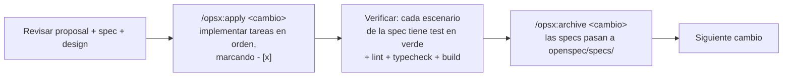
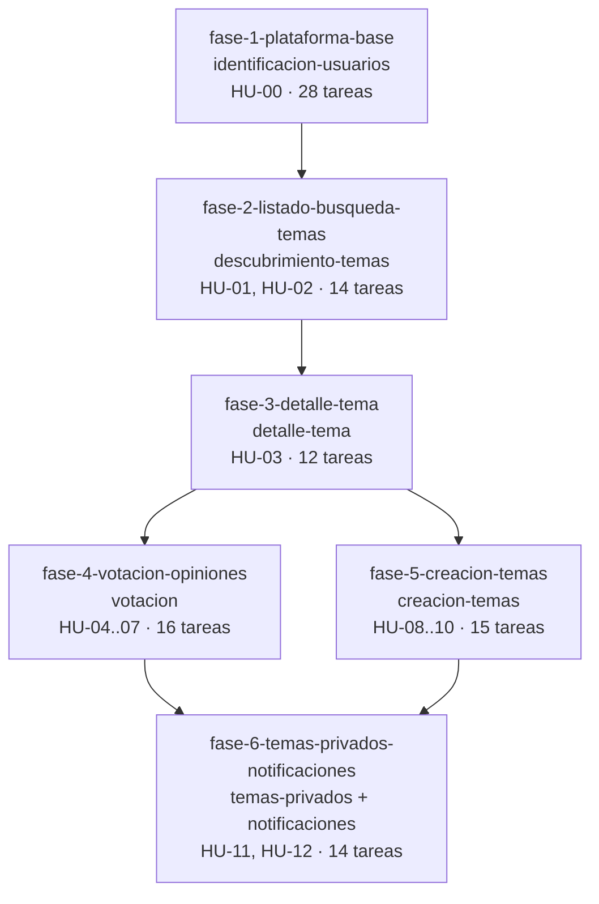

# 7. Desglose de tareas para el desarrollo (SDD)

## 7.1 Enfoque Spec Driven Development

El desarrollo se organiza con **OpenSpec** (esquema `spec-driven`). Cada incremento funcional es un **cambio** en `openspec/changes/<cambio>/` con cuatro artefactos:

| Artefacto                   | Pregunta que responde                                                                | Fuente                                                  |
| --------------------------- | ------------------------------------------------------------------------------------ | ------------------------------------------------------- |
| `proposal.md`               | ¿Por qué y qué capacidades se añaden?                                                | Definición del producto (docs/01)                       |
| `specs/<capacidad>/spec.md` | ¿Qué debe hacer el sistema? Requisitos `SHALL` + escenarios `WHEN/THEN` verificables | Historias y criterios de aceptación (docs/04)           |
| `design.md`                 | ¿Cómo se implementa? Decisiones, alternativas y riesgos                              | Arquitectura, modelo de datos y stack (docs/02, 03, 06) |
| `tasks.md`                  | ¿Qué pasos concretos hay que dar? Casillas `- [ ] X.Y`                               | Tickets (docs/05)                                       |

**Ciclo por cambio**

**Reglas de ejecución**

1. Los cambios se ejecutan **en orden** (fase 1 → fase 6); cada uno parte del estado archivado del anterior.
2. Una tarea solo se marca como hecha cuando su código y sus pruebas están en verde.
3. Cada grupo de tareas termina en una tarea de pruebas que cubre los escenarios de la spec; el nombre de cada test cita el escenario.
4. Si durante la implementación aparece un requisito no contemplado, **no se implementa**: se registra como cuestión abierta en docs/01 §1.8 y, si se aprueba, se crea un cambio nuevo.
5. `openspec validate --all --strict` debe pasar antes de empezar y después de modificar cualquier artefacto.

## 7.2 Orden y dependencias entre cambios

Las fases 4 y 5 solo dependen de la fase 3 y pueden desarrollarse en paralelo si hay más de una persona; la fase 6 requiere ambas.

| #   | Cambio                                 | Capacidades (specs)                | HU           | Tickets        | Tareas | Pts    |
| --- | -------------------------------------- | ---------------------------------- | ------------ | -------------- | ------ | ------ |
| 1   | `fase-1-plataforma-base`               | `identificacion-usuarios`          | HU-00        | TKT-001…010    | 28     | 21     |
| 2   | `fase-2-listado-busqueda-temas`        | `descubrimiento-temas`             | HU-01, HU-02 | TKT-011…015    | 14     | 11     |
| 3   | `fase-3-detalle-tema`                  | `detalle-tema`                     | HU-03        | TKT-016…018    | 12     | 6      |
| 4   | `fase-4-votacion-opiniones`            | `votacion`                         | HU-04…07     | TKT-019…023    | 16     | 13     |
| 5   | `fase-5-creacion-temas`                | `creacion-temas`                   | HU-08…10     | TKT-024…027    | 15     | 10     |
| 6   | `fase-6-temas-privados-notificaciones` | `temas-privados`, `notificaciones` | HU-11, HU-12 | TKT-028…032    | 14     | 9      |
|     | **Total**                              | **7 capacidades**                  | **13 HU**    | **32 tickets** | **99** | **70** |

## 7.3 Matriz de trazabilidad

| Requisito del producto                 | Funcionalidad | HU    | Requisito de spec                                                                                             | Tickets       |
| -------------------------------------- | ------------- | ----- | ------------------------------------------------------------------------------------------------------------- | ------------- |
| Usuarios identificados (S-01)          | —             | HU-00 | `identificacion-usuarios`: Registro, Inicio de sesión, Protección, Cierre de sesión                           | 006–008, 010  |
| §5.1 Lista scrolleable de temas        | F-01          | HU-01 | `descubrimiento-temas`: Lista scrolleable con carga continua                                                  | 011–013       |
| §5.1 Mayores tendencias sin búsqueda   | F-01          | HU-01 | `descubrimiento-temas`: Lista de tendencias en la pantalla principal                                          | 011–013       |
| §5.1 Buscador en la parte superior     | F-01          | HU-02 | `descubrimiento-temas`: Buscador de temas, Volver a las tendencias, Búsqueda sin resultados                   | 011, 012, 014 |
| §5.2 Entrar en el tema y ver el título | F-02          | HU-03 | `detalle-tema`: Título del tema, Tema no encontrado                                                           | 016, 017      |
| §5.2 Imagen en la mitad superior       | F-02          | HU-03 | `detalle-tema`: Imagen del tema en la mitad superior                                                          | 017           |
| §5.2 Botones 👍 verde / 👎 rojo        | F-02          | HU-03 | `detalle-tema`: Botones de voto                                                                               | 017           |
| §5.3.1–2 Justificación opcional        | F-03          | HU-05 | `votacion`: Justificación opcional del voto                                                                   | 019, 021      |
| §5.3.3 Emitir el voto                  | F-03          | HU-04 | `votacion`: Inicio del proceso, Cancelar, Voto único                                                          | 019, 021      |
| §5.3.4 Totales positivos/negativos     | F-03          | HU-06 | `votacion`: Resultados tras votar; `detalle-tema`: Resultados si el usuario ya votó                           | 019, 022      |
| §5.3.4 Opiniones verde/rojo            | F-03          | HU-07 | `votacion`: Lista de opiniones coloreada, Estado sin opiniones, Opiniones solo para quien ha votado           | 020, 022      |
| §6 Crear temas desde el menú           | F-04          | HU-08 | `creacion-temas`: Acceso desde el menú, Datos del tema, Creación de un tema público                           | 025, 026      |
| §5.2 / §6 Imagen adjunta               | F-04          | HU-09 | `creacion-temas`: Imagen adjunta opcional                                                                     | 024–026       |
| §6 Temas privados                      | F-04, F-06    | HU-10 | `creacion-temas`: Creación de un tema privado                                                                 | 025, 026      |
| §6.2 Solo amigos acceden               | F-06          | HU-11 | `temas-privados`: Acceso de los amigos, Denegación a no amigos, Acceso del creador                            | 028           |
| §6.2 Notificación a amigos             | F-06          | HU-12 | `notificaciones`: Notificación a los amigos, Pantalla de notificaciones, Acceso al tema desde la notificación | 029–031       |

## 7.4 Desglose completo de tareas

> La fuente de verdad son los ficheros `openspec/changes/<cambio>/tasks.md`; esta sección es una copia de referencia generada a partir de ellos.

### Fase 1 · `fase-1-plataforma-base`

#### 1. Proyecto base (TKT-001)

- [ ] 1.1 Crear el proyecto Next.js 15 con App Router, carpeta `src/`, TypeScript `strict` y Tailwind CSS
- [ ] 1.2 Configurar ESLint y Prettier y añadir scripts `lint`, `typecheck` y `format`
- [ ] 1.3 Configurar Vitest + Testing Library (`test`) con entorno jsdom para componentes y node para servidor
- [ ] 1.4 Configurar Playwright (`test:e2e`) con viewport móvil por defecto (390×844)
- [ ] 1.5 Crear la estructura de carpetas de `docs/02-arquitectura.md §2.7`

#### 2. Entorno local (TKT-002)

- [ ] 2.1 Crear `docker-compose.yml` con PostgreSQL 16 (BD `opina` y `opina_test`) y MinIO con bucket `opina-images` de lectura pública
- [ ] 2.2 Crear `.env.example` con `DATABASE_URL`, `AUTH_SECRET` y variables `S3_*`
- [ ] 2.3 Implementar `src/server/env.ts` que valide las variables con Zod y falle al arrancar si falta alguna

#### 3. Base de datos (TKT-003, TKT-004)

- [ ] 3.1 Escribir `prisma/schema.prisma` según `docs/03-modelo-datos.md §3.4`
- [ ] 3.2 Generar la migración inicial y añadir el SQL manual (pg_trgm, índice trigram, CHECKs)
- [ ] 3.3 Crear el cliente Prisma singleton en `src/server/db/client.ts`
- [ ] 3.4 Implementar `prisma/seed.ts` idempotente según `docs/03-modelo-datos.md §3.6` (usuarios y amistades; los temas se completan en fases posteriores si hace falta)

#### 4. Utilidades comunes de servidor (TKT-005)

- [ ] 4.1 Definir errores de dominio en `src/server/errors.ts` (`ValidationError`, `UnauthorizedError`, `ForbiddenError`, `NotFoundError`, `ConflictError`)
- [ ] 4.2 Implementar `toHttpResponse(error)` con el formato `{ error: { code, message } }` y códigos 400/401/403/404/409/413/415/500
- [ ] 4.3 Implementar `encodeCursor`/`decodeCursor` (base64url + validación Zod)
- [ ] 4.4 Tests unitarios de mapeo de errores y cursores

#### 5. Autenticación (TKT-006)

- [ ] 5.1 Esquemas Zod `registerSchema` y `loginSchema` en `src/lib/validation/auth.ts`
- [ ] 5.2 Implementar `AuthService.register` (normaliza email, hash bcrypt coste 12, `ConflictError` si existe) y `AuthService.verifyCredentials`
- [ ] 5.3 Configurar Auth.js v5 (Credentials, sesión JWT con `id` y `username`) en `src/server/auth`
- [ ] 5.4 Implementar `POST /api/register` y el helper `requireUser()`

#### 6. Interfaz de identificación y layout (TKT-007, TKT-008)

- [ ] 6.1 Pantalla `/registro` con validación y errores de campo; inicia sesión tras registrarse y redirige a `/`
- [ ] 6.2 Pantalla `/login` con mensaje "Credenciales incorrectas"; redirige a `/`
- [ ] 6.3 Layout raíz mobile-first con `MainMenu` que incluye "Cerrar sesión"
- [ ] 6.4 `src/middleware.ts`: redirección a `/login` en páginas y `401` en `/api/*` sin sesión, con las excepciones públicas
- [ ] 6.5 Página `/` provisional (se sustituye en la fase 2)

#### 7. CI (TKT-009)

- [ ] 7.1 Workflow de GitHub Actions con servicio PostgreSQL: install, `prisma migrate deploy`, lint, typecheck, test, build, test:e2e

#### 8. Pruebas (TKT-010)

- [ ] 8.1 Integración de `AuthService` y `POST /api/register`: registro correcto, conflicto, datos inválidos y ausencia de hash en respuestas
- [ ] 8.2 E2E: registro correcto, credenciales incorrectas, visitante redirigido a `/login`, `401` en API sin sesión y cierre de sesión

### Fase 2 · `fase-2-listado-busqueda-temas`

#### 1. Servicio de dominio (TKT-011)

- [ ] 1.1 Crear `TopicService.listTrending({ cursor })`: solo `PUBLIC`, orden `totalVotes DESC, createdAt DESC, id DESC`, keyset de 20, devuelve `{ items: TopicSummary[], nextCursor }`
- [ ] 1.2 Crear `TopicService.search({ q, cursor })`: `ILIKE` sobre el título con escape de `%`, `_` y `\`, mismo orden y paginación
- [ ] 1.3 Ampliar `prisma/seed.ts` con 25 temas públicos con votos variados (algunos con imagen)

#### 2. API (TKT-012)

- [ ] 2.1 Esquema Zod `listTopicsQuerySchema` (`q` opcional 1–100 caracteres tras `trim`, `cursor` opcional)
- [ ] 2.2 Implementar `GET /api/topics` en `src/app/api/topics/route.ts` (sin `q` → tendencias; con `q` → búsqueda)

#### 3. Pantalla principal (TKT-013)

- [ ] 3.1 Configurar el `QueryClientProvider` de TanStack Query en el layout raíz
- [ ] 3.2 Crear `TopicListItem` (título, enlace a `/temas/[id]`, área táctil ≥ 44 px)
- [ ] 3.3 Crear `TopicList` con `useInfiniteQuery`, centinela con `IntersectionObserver`, deduplicación por `id`, estados de carga, vacío y error
- [ ] 3.4 Reemplazar la página `/` provisional por `HomePage` con primera página renderizada en servidor

#### 4. Buscador (TKT-014)

- [ ] 4.1 Crear `SearchBar` fijo en la parte superior con debounce de 300 ms y sincronización con `?q=`
- [ ] 4.2 Conectar `SearchBar` con `TopicList`: texto vacío → tendencias; texto → búsqueda; mensaje "sin resultados"

#### 5. Pruebas (TKT-015)

- [ ] 5.1 Integración de `TopicService`: orden por tendencia, desempate por fecha, paginación sin repetidos, exclusión de privados, búsqueda insensible a mayúsculas y escape de `%`
- [ ] 5.2 Test de componente de `TopicList` (estado vacío, fin de lista) y `SearchBar` (debounce, vaciar)
- [ ] 5.3 E2E: scroll carga más temas, búsqueda filtra, vaciar búsqueda vuelve a tendencias, pulsar un tema navega a su pantalla

### Fase 3 · `fase-3-detalle-tema`

#### 1. Visibilidad y detalle (TKT-016)

- [ ] 1.1 Implementar `VisibilityPolicy.canAccess(topic, viewerId, { areFriends })` en `src/server/services/visibility-policy.ts` (público → sí; privado → creador; `areFriends` inyectado devolviendo `false` en esta fase)
- [ ] 1.2 Implementar `TopicService.getById(id, viewerId)` que lanza `NotFoundError` si no existe o no hay acceso y devuelve `TopicDetail` con `myVote` y `results` solo si `myVote` no es nulo
- [ ] 1.3 Implementar `GET /api/topics/:id` en `src/app/api/topics/[id]/route.ts`

#### 2. Pantalla de tema (TKT-017)

- [ ] 2.1 Configurar `images.remotePatterns` de Next.js con el dominio de `S3_PUBLIC_URL`
- [ ] 2.2 Crear `TopicImage` (`h-[50dvh] w-full object-cover`, `priority`), renderizado solo si hay `imageUrl`
- [ ] 2.3 Crear `VoteButtons` fijos en la parte inferior: 👍 verde y 👎 rojo con `aria-label`, con callback `onSelect(value)` (sin acción de red en esta fase)
- [ ] 2.4 Crear `src/app/temas/[id]/page.tsx` (`TopicPage`): imagen opcional, título y `VoteButtons` o un contenedor `VoteResults` provisional si `myVote` existe
- [ ] 2.5 Crear `src/app/temas/[id]/not-found.tsx` con enlace a la pantalla principal

#### 3. Pruebas (TKT-018)

- [ ] 3.1 Unitarios de `VisibilityPolicy` (público, privado propio, privado ajeno)
- [ ] 3.2 Integración de `GET /api/topics/:id`: tema público, inexistente (404), privado ajeno (404), sin totales si no ha votado, con totales si ha votado (voto insertado por seed)
- [ ] 3.3 Tests de componente de `TopicPage`: con imagen, sin imagen, no votado (botones), votado (resultados)
- [ ] 3.4 E2E en viewport 390×844: desde la lista se entra en un tema con imagen, la imagen mide la mitad de la altura y los botones están abajo

### Fase 4 · `fase-4-votacion-opiniones`

#### 1. Emisión de voto (TKT-019)

- [ ] 1.1 Esquema Zod `castVoteSchema` (`value: "UP" | "DOWN"`, `justification` opcional, `trim`, ≤ 500, vacía → `null`) en `src/lib/validation/vote.ts`
- [ ] 1.2 Implementar `VoteService.castVote(topicId, userId, value, justification)` en una transacción: `VisibilityPolicy` → insert → incremento de contadores; `P2002` → `ConflictError`
- [ ] 1.3 Implementar `POST /api/topics/:id/votes` que responde `201 { positiveVotes, negativeVotes, myVote }`

#### 2. Opiniones (TKT-020)

- [ ] 2.1 Implementar `VoteService.listOpinions(topicId, viewerId, cursor)`: comprueba acceso (`404`) y voto previo (`ForbiddenError`), filtra `justification IS NOT NULL`, orden `createdAt DESC, id DESC`, keyset 20, incluye `username`
- [ ] 2.2 Implementar `GET /api/topics/:id/opinions`

#### 3. Flujo de voto en la UI (TKT-021)

- [ ] 3.1 Crear `JustificationDialog` accesible (`role="dialog"`, foco atrapado, `Esc` cancela) con `textarea` opcional y contador 0/500, botones "Cancelar" y "Votar"
- [ ] 3.2 Conectar `VoteButtons.onSelect` para abrir el diálogo con el valor elegido
- [ ] 3.3 Al confirmar: mutación con TanStack Query, botón deshabilitado durante la petición, `409` tratado como ya votado (recargar tema), errores de validación mostrados en el diálogo

#### 4. Resultados y opiniones (TKT-022)

- [ ] 4.1 Crear `VoteResults` con los totales 👍 (verde) y 👎 (rojo) y sustituir `VoteButtons` tras el voto sin recargar
- [ ] 4.2 Crear `OpinionItem` (verde para `UP`, rojo para `DOWN`, icono, nombre de usuario y justificación)
- [ ] 4.3 Crear `OpinionList` con `useInfiniteQuery`, scroll continuo y estado "Aún no hay opiniones"
- [ ] 4.4 Sustituir el contenedor provisional de resultados de `TopicPage` por `VoteResults` e invalidar las cachés del tema y de tendencias tras votar

#### 5. Pruebas (TKT-023)

- [ ] 5.1 Integración de `VoteService.castVote`: voto positivo/negativo, justificación vacía/espacios/501 caracteres, segundo voto `409`, dos votos concurrentes → un único incremento, tema sin acceso `404`
- [ ] 5.2 Integración de `listOpinions`: solo con justificación, orden, paginación de 30, `403` sin voto
- [ ] 5.3 Tests de componente: `JustificationDialog` (cancelar, confirmar vacío, límite), `OpinionItem` (colores)
- [ ] 5.4 E2E: votar positivo con justificación → totales y opinión verde; votar negativo sin justificación → totales sin nueva opinión; reentrar en el tema → se ven resultados, no botones

### Fase 5 · `fase-5-creacion-temas`

#### 1. Almacenamiento de imágenes (TKT-024)

- [ ] 1.1 Definir la interfaz `ImageStorage` (`upload(file) → { url, key }`, `remove(key)`) en `src/server/storage`
- [ ] 1.2 Implementar `S3ImageStorage` con `@aws-sdk/client-s3` (`forcePathStyle` para MinIO) y clave `topics/<uuid>.<ext>`
- [ ] 1.3 Implementar la validación: tamaño ≤ 5 MB (`413`) y tipo JPEG/PNG/WebP por magic bytes con `file-type` (`415`)
- [ ] 1.4 Implementar `InMemoryImageStorage` para tests y seleccionarla por variable de entorno en test

#### 2. Creación de temas (TKT-025)

- [ ] 2.1 Esquema Zod `createTopicSchema` (`title` 3–120 tras `trim`, `visibility` `PUBLIC|PRIVATE`) en `src/lib/validation/topic.ts`
- [ ] 2.2 Implementar `TopicService.create(input, authorId)`: validar → subir imagen si existe → insertar; borrado de mejor esfuerzo de la imagen si falla la inserción
- [ ] 2.3 Añadir el método `POST` a `src/app/api/topics/route.ts` leyendo `formData()`, con límite de body de 6 MB, respuesta `201 { id }`

#### 3. Interfaz de creación (TKT-026)

- [ ] 3.1 Añadir la opción "Crear tema" al `MainMenu`
- [ ] 3.2 Crear `src/app/temas/nuevo/page.tsx` con campo de título, selector de imagen opcional (`accept="image/jpeg,image/png,image/webp"`) y selector Público/Privado (Público por defecto)
- [ ] 3.3 Validación en cliente con el mismo esquema Zod, errores por campo (título, imagen) y botón deshabilitado durante el envío
- [ ] 3.4 Tras `201`, invalidar la caché de tendencias y redirigir a `/temas/[id]`

#### 4. Pruebas (TKT-027)

- [ ] 4.1 Unitarios de validación de imagen: PNG válido, 6 MB (`413`), PDF renombrado a `.jpg` (`415`)
- [ ] 4.2 Integración de `POST /api/topics`: público sin imagen, público con imagen, privado, título de 2 y 121 caracteres
- [ ] 4.3 Integración: el tema privado creado no aparece en `GET /api/topics` ni en búsquedas; el creador obtiene `200` en `GET /api/topics/:id`
- [ ] 4.4 E2E: crear un tema público con imagen desde el menú → se muestra con la imagen a media pantalla → otro usuario lo encuentra en la búsqueda

### Fase 6 · `fase-6-temas-privados-notificaciones`

#### 1. Amistades y acceso a temas privados (TKT-028)

- [ ] 1.1 Implementar `FriendshipService.areFriends(userId, otherId)` y `getFriendIds(userId)` en `src/server/services/friendship-service.ts`
- [ ] 1.2 Inyectar `FriendshipService.areFriends` en `VisibilityPolicy` (privado → creador o amigo del creador)
- [ ] 1.3 Verificar que `TopicService.getById`, `VoteService.castVote` y `VoteService.listOpinions` usan la política ampliada (sin duplicar lógica)

#### 2. Generación de notificaciones (TKT-029)

- [ ] 2.1 Implementar `NotificationService.notifyFriendsOfPrivateTopic(topic, tx)` con un único `INSERT … SELECT` desde `friendships`
- [ ] 2.2 Envolver `TopicService.create` en una transacción que, si `visibility = PRIVATE`, invoque `notifyFriendsOfPrivateTopic`
- [ ] 2.3 Ampliar `prisma/seed.ts` con un tema privado de `ana` y sus notificaciones a `bruno` y `carla`

#### 3. API de notificaciones (TKT-030)

- [ ] 3.1 Implementar `NotificationService.listForUser(userId, cursor)` (keyset 20, `createdAt DESC, id DESC`, con `actor.username` y `topic.{id,title}`)
- [ ] 3.2 Implementar `GET /api/notifications` en `src/app/api/notifications/route.ts`

#### 4. Pantalla de notificaciones (TKT-031)

- [ ] 4.1 Añadir la opción "Notificaciones" al `MainMenu`
- [ ] 4.2 Crear `src/app/notificaciones/page.tsx` con lista scrolleable, texto "<usuario> ha creado una nueva propuesta: <título>", enlace a `/temas/[id]` y estado vacío

#### 5. Pruebas (TKT-032)

- [ ] 5.1 Integración de la política: creador, amigo y no amigo en detalle (`200`/`200`/`404`), voto (`201`/`201`/`404`) y opiniones
- [ ] 5.2 Integración de notificaciones: privado con 2 amigos → 2 notificaciones; público → 0; sin amigos → 0; atomicidad (fallo simulado al notificar → no se crea el tema)
- [ ] 5.3 Integración de `GET /api/notifications`: orden y solo las propias
- [ ] 5.4 E2E: `ana` crea un tema privado → `bruno` ve la notificación, la pulsa, vota y ve resultados → `dani` recibe "tema no encontrado" en la misma URL

## 7.5 Criterio de finalización del proyecto

- Los 6 cambios están archivados y `openspec/specs/` contiene las 7 capacidades.
- Todos los escenarios de las specs tienen al menos un test en verde (unitario, integración o e2e).
- El pipeline de CI (lint, typecheck, tests, build, e2e) pasa en la rama principal.
- No se ha implementado ninguna funcionalidad fuera de docs/01-producto.md; las cuestiones abiertas (Q-01…Q-03) siguen registradas para su decisión.
