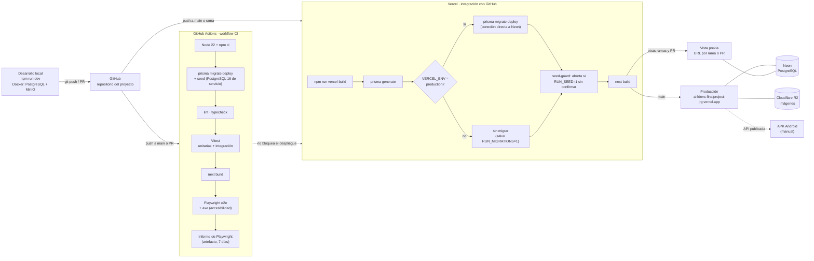
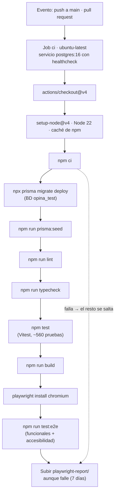

# 12 · Integración y despliegue continuos (CI/CD)

Cómo llega un cambio desde el ordenador hasta producción, qué comprueba cada paso y qué falta por cerrar. Describe lo que **existe hoy** (`.github/workflows/ci.yml`, `scripts/vercel-build.mjs`, `docker-compose.yml`), no un diseño futuro. Los pasos de creación del entorno de producción están en [`08-despliegue-vercel.md`](08-despliegue-vercel.md).

## 12.1 Visión general

Hay **dos canalizaciones independientes** que se disparan con el mismo `git push`: el CI de GitHub Actions comprueba el código y la integración de Vercel lo construye y lo publica. **La segunda no espera a la primera** (ver §12.5).

## 12.2 Entornos

| Entorno | Qué ejecuta | Base de datos | Imágenes | Cómo se llega |
| --- | --- | --- | --- | --- |
| **Local** | `npm run dev` | PostgreSQL 16 en Docker (puerto 5433; bases `opina` y `opina_test`) | MinIO en Docker (9000 y 9001) | `docker compose up -d` |
| **CI** | Workflow `CI` en `ubuntu-latest`, Node 22 | PostgreSQL 16 como servicio (`opina_test`), con migraciones y seed | En memoria (`IMAGE_STORAGE=memory`), sin MinIO | `push` a `main` y cualquier PR |
| **Vista previa** | Despliegue de Vercel por rama o PR | La de Neon configurada para _Preview_ (sin migrar, salvo `RUN_MIGRATIONS=1`) | R2 | Push a una rama |
| **Producción** | Despliegue de Vercel de `main` | Neon | Cloudflare R2 | Push a `main` |
| **APK Android** | Interfaz empaquetada con Capacitor | La API de producción | La API (`/api/media`) | Manual: `npm run build:mobile` y `npm run android:apk` |

Los contenedores de Docker son solo los **servicios** (PostgreSQL y MinIO). La aplicación no se empaqueta en un contenedor porque Vercel la construye y la sirve.

## 12.3 El CI, paso a paso

Definido en [`.github/workflows/ci.yml`](../.github/workflows/ci.yml). Se ejecuta en `push` a `main` y en todas las pull requests.

| Paso | Qué comprueba | Falla si |
| --- | --- | --- |
| `npm ci` | Que `package-lock.json` y `package.json` están sincronizados | El lock no es compatible con npm 10 (el de Node 22) |
| `migrate deploy` + seed | Que las migraciones se aplican de cero y el seed funciona | Una migración falla |
| `lint` y `typecheck` | ESLint y `tsc --noEmit` | Hay errores |
| `npm test` | Pruebas unitarias y de integración (criterios de aceptación incluidos, [`10`](10-trazabilidad-criterios.md)) | Cualquier prueba falla |
| `npm run build` | Que Next.js compila y las variables de entorno son válidas | Error de compilación |
| `npm run test:e2e` | Flujos completos en Chromium y axe-core | Falla un e2e o hay infracciones de accesibilidad |

## 12.4 El despliegue, paso a paso

Lo hace Vercel con [`scripts/vercel-build.mjs`](../scripts/vercel-build.mjs) (`npm run vercel-build`):

1. **`prisma generate`**, porque Vercel cachea `node_modules`.
2. **Migraciones**: `prisma migrate deploy` por la conexión **directa** de Neon (sin _pooling_), **solo si** `VERCEL_ENV=production` o `RUN_MIGRATIONS=1`. Una rama no toca la base de datos de producción.
3. **Seed protegido**: si hay `RUN_SEED=1` en producción sin `ALLOW_PRODUCTION_SEED=1`, el build termina con error (`scripts/seed-guard.mjs`).
4. **`next build`**.

Si algo falla, Vercel **no publica** esa versión y la anterior sigue en producción. Las migraciones son aditivas, así que la versión anterior del código sigue funcionando aunque la base de datos ya esté migrada.

**Rollback:** en Vercel, _Deployments → Promote to Production_ sobre un despliegue anterior. La base de datos no se revierte; por eso las migraciones deben ser compatibles con la versión anterior.

## 12.5 Lo que falta (estado a 8 de noviembre de 2026)

| Hueco | Detalle | Qué hacer |
| --- | --- | --- |
| **El CI estaba en rojo desde el primer commit** | Fallaba en `npm ci`: el lock se generó con npm 11 y el CI usa npm 10 («Missing: magicast@0.3.5 from lock file»). Ningún paso posterior llegó a ejecutarse. | **Corregido en local** (lock regenerado con npm 10, que también vale para npm 11; el CI define `IMAGE_STORAGE=memory`). **Falta comprobarlo en GitHub tras el push**: pueden aparecer fallos nuevos en los pasos que nunca se ejecutaron. |
| **El despliegue no espera al CI** | Vercel publica al recibir el push aunque el CI falle. Ya ocurrió: el 8 de noviembre se desplegó a producción con el CI en rojo. | En GitHub, proteger `main` exigiendo el check `ci` en las PR; en Vercel, activar _Deployment Checks_ o desplegar desde Actions. |
| **Sin PR obligatoria** | Se trabaja con `push` directo a `main`, así que el CI llega tarde. | Una rama y una PR por cambio, con el CI como requisito. |
| **La APK no se construye en CI** | Se compila a mano. | Opcional: un workflow que construya la APK de depuración como artefacto. |
| **No hay contenedor de la aplicación** | Solo PostgreSQL y MinIO están en Docker. | Opcional: un `Dockerfile` y un servicio `app` en `docker-compose.yml` para reproducir el entorno completo en local. |
| **Sin revisión automática de dependencias** | `npm audit` avisa de vulnerabilidades, que no se revisan. | Opcional: Dependabot. |

## 12.6 Cómo ver el estado

- **Último CI:** pestaña _Actions_ del repositorio, o
  `curl -s https://api.github.com/repos/Morius2100/ai4devs-finalproject--JRG-/actions/runs?per_page=1`
- **Producción:** `https://ai4devs-finalproject-jrg.vercel.app/api/health` debe responder `200`; las cabeceras de seguridad confirman que corre la versión reciente.
- **En local, antes de subir:** `npm run lint && npm run typecheck && npm test`, y `npx -y npm@10 ci --dry-run` si se ha tocado `package-lock.json`.
