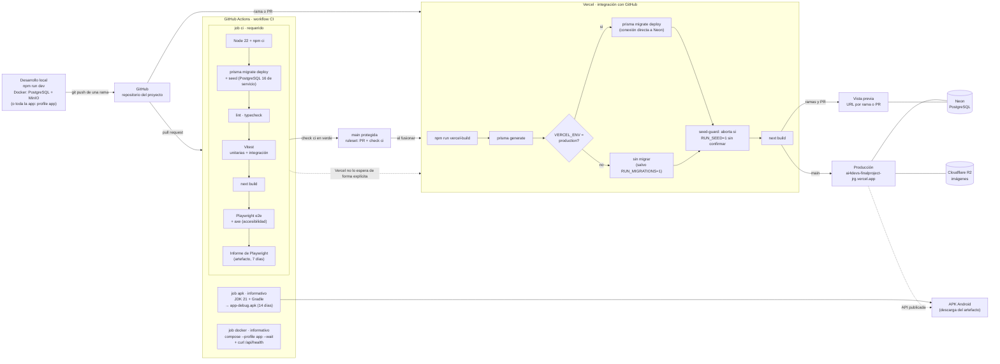
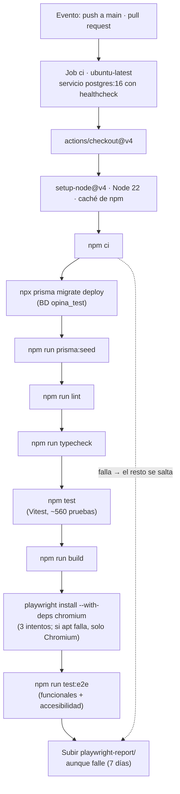

# 12 · Integración y despliegue continuos (CI/CD)

Cómo llega un cambio desde el ordenador hasta producción, qué comprueba cada paso y qué falta por cerrar. Describe lo que **existe en el repositorio** (`.github/workflows/ci.yml`, `.github/rulesets/main.json`, `scripts/vercel-build.mjs`, `Dockerfile`, `docker-compose.yml`). Los pasos de creación del entorno de producción están en [`08-despliegue-vercel.md`](08-despliegue-vercel.md).

## 12.1 Visión general

`main` está pensada para recibir cambios **solo mediante pull request con el check `ci` en verde** (§12.6). Como Vercel despliega `main` al recibir una fusión, lo que llega a producción ya ha pasado el CI. Vercel sigue siendo una integración aparte: **no espera de forma explícita** al CI (§12.5).



## 12.2 Entornos

| Entorno | Qué ejecuta | Base de datos | Imágenes | Cómo se llega |
| --- | --- | --- | --- | --- |
| **Local** | `npm run dev` | PostgreSQL 16 en Docker (puerto 5433; bases `opina` y `opina_test`) | MinIO en Docker (9000 y 9001) | `docker compose up -d` |
| **Local en contenedor** | La aplicación completa (`Dockerfile`) | La misma PostgreSQL de Docker | La misma MinIO | `docker compose --profile app up -d --build` (puerto 3000) |
| **CI** | Workflow `CI` en `ubuntu-latest`, Node 22 | PostgreSQL 16 como servicio (`opina_test`), con migraciones y seed | En memoria (`IMAGE_STORAGE=memory`), sin MinIO | Cualquier PR y `push` a `main` |
| **Vista previa** | Despliegue de Vercel por rama o PR | La de Neon configurada para _Preview_ (sin migrar, salvo `RUN_MIGRATIONS=1`) | R2 | Push de una rama |
| **Producción** | Despliegue de Vercel de `main` | Neon | Cloudflare R2 | Fusionar una PR en `main` |
| **APK Android** | Interfaz empaquetada con Capacitor | La API de producción | La API (`/api/media`) | Descargar `opina-debug-apk` del CI, o `npm run build:mobile` y `npm run android:apk` |

## 12.3 Los jobs del CI

Definidos en [`.github/workflows/ci.yml`](../.github/workflows/ci.yml). Se ejecutan en `push` a `main` y en todas las pull requests.

### Job `ci` (requerido)



| Paso | Qué comprueba | Falla si |
| --- | --- | --- |
| `npm ci` | Que `package-lock.json` y `package.json` están sincronizados | El lock no es compatible con npm 10 (el de Node 22) |
| `migrate deploy` + seed | Que las migraciones se aplican de cero y el seed funciona | Una migración falla |
| `lint` y `typecheck` | ESLint y `tsc --noEmit` | Hay errores |
| `npm test` | Pruebas unitarias y de integración (criterios de aceptación incluidos, [`10`](10-trazabilidad-criterios.md)) | Cualquier prueba falla |
| `npm run build` | Que Next.js compila y las variables de entorno son válidas | Error de compilación |
| `npm run test:e2e` | Flujos completos en Chromium y axe-core | Falla un e2e o hay infracciones de accesibilidad |

### Job `apk` (informativo)

Construye la APK de depuración: `npm run build:mobile` (export estático y `cap sync android`), plataforma de Android 36 si falta, y `./gradlew assembleDebug` con JDK 21 y caché de Gradle. Sube `app-debug.apk` como artefacto `opina-debug-apk` durante 14 días. Está firmada con la clave de depuración, se instala directamente y apunta al servidor de Vercel por HTTPS. **No es un check requerido**: tarda varios minutos y no debe bloquear cambios ajenos a la app. La APK de _release_ para Google Play queda fuera (necesita un _keystore_ propio).

### Job `docker` (informativo)

Ejecuta `docker compose --profile app up -d --build --wait`, que construye la imagen, arranca la aplicación con PostgreSQL y MinIO, **aplica las migraciones sobre una base de datos vacía** y espera a que el `HEALTHCHECK` pase; después pide `/api/health`. Si falla, muestra los registros del contenedor. No publica la imagen.

## 12.4 El despliegue, paso a paso

Lo hace Vercel con [`scripts/vercel-build.mjs`](../scripts/vercel-build.mjs) (`npm run vercel-build`):

1. **`prisma generate`**, porque Vercel cachea `node_modules`.
2. **Migraciones**: `prisma migrate deploy` por la conexión **directa** de Neon (sin _pooling_), **solo si** `VERCEL_ENV=production` o `RUN_MIGRATIONS=1`. Una rama no toca la base de datos de producción.
3. **Seed protegido**: si hay `RUN_SEED=1` en producción sin `ALLOW_PRODUCTION_SEED=1`, el build termina con error (`scripts/seed-guard.mjs`).
4. **`next build`**.

Si algo falla, Vercel **no publica** esa versión y la anterior sigue en producción. Las migraciones son aditivas, así que la versión anterior del código sigue funcionando aunque la base de datos ya esté migrada.

**Rollback:** en Vercel, _Deployments → Promote to Production_ sobre un despliegue anterior. La base de datos no se revierte; por eso las migraciones deben ser compatibles con la versión anterior.

## 12.5 Estado y huecos (8 de noviembre de 2026)

| Punto | Estado | Detalle |
| --- | --- | --- |
| **CI en rojo desde el primer commit** | **Corregido y en verde en GitHub (9 de noviembre de 2026)** | Fallaba en `npm ci` (lock de npm 11 frente al npm 10 de Node 22). Al regenerar el lock, los pasos siguientes se ejecutaron por primera vez y solo falló un e2e de accesibilidad (esperaba sin asegurarse de que el tema hubiera cargado), ya corregido. |
| **Instalación de Playwright en el CI** | **Mitigada; pendiente de confirmar en GitHub** | El 10 y el 11 de noviembre de 2026 el job `ci` fallaba en `playwright install --with-deps chromium`: `ubuntu-latest` ya era Ubuntu 26.04 y `apt` no resolvía los servidores de Ubuntu, así que los e2e no se ejecutaban. El paso reintenta tres veces y, si `apt` sigue sin responder, instala solo Chromium (las bibliotecas ya vienen en la imagen). Falta ver una ejecución en verde. |
| **Imagen `ubuntu-24.04` descartada** | Probada el 11 de noviembre de 2026 | Fijar el job `ci` en `ubuntu-24.04` movió el fallo a `next build`: `next/font/google` no pudo procesar la descarga de la fuente Nunito (`TypeError` en el cargador), mientras `apk` y `docker`, en `ubuntu-latest`, compilaban bien en el mismo run. Se volvió a `ubuntu-latest`. El `next build` sigue dependiendo de Google Fonts: alojar la fuente en el repositorio (`next/font/local`) lo eliminaría. |
| **`main` protegida** | **Preparada, falta importar el _ruleset_** | [`.github/rulesets/main.json`](../.github/rulesets/main.json) lo define. Hay que importarlo a mano (§12.6) y solo cuando el CI esté en verde. |
| **Contenedor de la aplicación** | **Hecho y verificado en local y en GitHub** | `Dockerfile` y servicio `app`: la imagen se construye (667 MB), arranca sana, corre como usuario `node`, aplica las migraciones y permite registrarse, iniciar sesión y crear un tema con imagen. El job `docker` pasa en GitHub, con las migraciones sobre una base vacía. |
| **APK en el CI** | **Hecho en GitHub; falta probarla en un móvil** | El job `apk` pasa a la primera y sube `opina-debug-apk`. Falta descargarla, instalarla y comprobar que se conecta al servidor de producción. |
| **Vercel no espera al CI de forma explícita** | **Hueco residual aceptado** | Con `main` protegida, lo que se despliega ya pasó el CI en su PR. Pero (a) si el propietario fusiona saltándose el check, o (b) si el CI falla sobre el commit de fusión, Vercel despliega igualmente. |
| **Mejora futura para cerrarlo** | Opcional | Un job `deploy` con `needs: ci` que publique con la CLI de Vercel y desactivar el despliegue automático de `main` (`vercel.json`). Exige tres secretos en GitHub (`VERCEL_TOKEN`, `VERCEL_ORG_ID`, `VERCEL_PROJECT_ID`) y mover el build al ejecutor de GitHub. |
| **Revisión automática de dependencias** | Sin hacer | `npm audit` avisa de vulnerabilidades que nadie revisa. Opcional: Dependabot. |

## 12.6 Flujo de trabajo con ramas y pull requests

Con `main` protegida **ya no se hace `git push origin main`**. Cada cambio sigue este camino:

```bash
git switch -c feat/mi-cambio          # una rama por cambio
# … trabajar y commitear …
git push -u origin feat/mi-cambio     # Vercel crea la vista previa de la rama
# En GitHub: abrir la pull request. El check «ci» se ejecuta solo.
# Con «ci» en verde: «Merge pull request». Vercel despliega main.
git switch main && git pull           # volver a main actualizada
```

No hace falta que nadie apruebe la PR: el CI es la puerta de calidad.

### Activar la protección (una sola vez, a mano)

1. **Antes**, comprobar en la pestaña _Actions_ que el job `ci` pasa. Con un CI en rojo, la protección impediría fusionar cualquier cosa.
2. En GitHub: repositorio → **Settings → Rules → Rulesets → New ruleset → Import a ruleset** → elegir `.github/rulesets/main.json` → **Create**.
3. Si el importador rechaza la lista de excepciones, añadir a mano en _Bypass list_ el rol **Repository admin** con el modo **For pull requests only**.
4. Comprobar: `git push origin main` con un commit nuevo debe rechazarse, también para el propietario.

**Qué hace el _ruleset_:** exige PR, exige el check `ci` y que la rama esté al día, prohíbe `force push` y el borrado de `main`, y no pide aprobaciones. El propietario puede fusionar una PR saltándose el check en una urgencia (**solo mediante PR**, nunca con `push` directo); queda registrado en la propia PR.

### Desactivarla

_Settings → Rules → Rulesets → Proteger main_ → **Enforcement: Disabled** (o _Delete_). No hay que tocar nada en el repositorio.

## 12.7 La aplicación en un contenedor

```bash
docker compose --profile app up -d --build   # PostgreSQL + MinIO + la aplicación → http://localhost:3000
docker compose --profile app logs -f app     # registros (migraciones al arrancar)
docker compose --profile app rm -sf app      # parar solo la aplicación y dejar PostgreSQL y MinIO
```

- El puerto 3000 es el de `npm run dev`: para uno de los dos.
- La imagen se construye con valores **de relleno** para las variables que `next build` exige; los reales se pasan al arrancar. No lleva secretos.
- Al arrancar aplica `prisma migrate deploy` (se omite con `RUN_MIGRATIONS=0`).
- En un contenedor no hay `VERCEL` y `NODE_ENV` es `production`, así que el servicio define `AUTH_TRUST_HOST=true` (ver `src/server/auth/config.ts`).
- `docker compose up -d` sin `--profile app` sigue arrancando solo PostgreSQL y MinIO.
- El `Dockerfile` activa la salida `standalone` de Next.js con `NEXT_OUTPUT=standalone`; sin esa variable, el build de Vercel y el de la APK son los de siempre.

## 12.8 Cómo ver el estado

- **Último CI:** pestaña _Actions_ del repositorio, o
  `curl -s https://api.github.com/repos/Morius2100/ai4devs-finalproject--JRG-/actions/runs?per_page=1`
- **Producción:** `https://ai4devs-finalproject-jrg.vercel.app/api/health` debe responder `200`; las cabeceras de seguridad confirman que corre la versión reciente.
- **En local, antes de subir:** `npm run lint && npm run typecheck && npm test`, y `npx -y npm@10 ci --dry-run` si se ha tocado `package-lock.json`.
